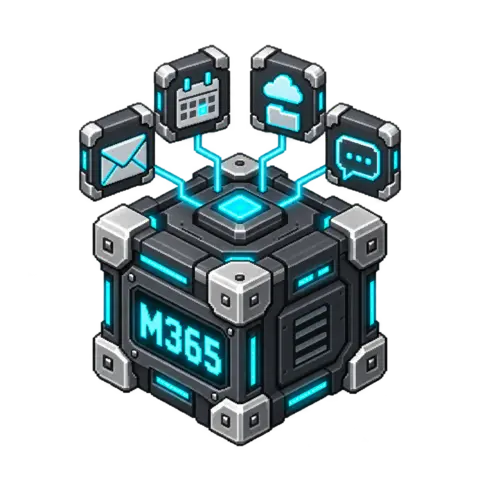

# Microsoft 365

Work with Outlook mail and calendar, OneDrive files and Teams messages. The block
lists, reads, sends, moves and marks Outlook mail and downloads attachments; lists
a calendar window and creates, updates or deletes events; lists, downloads and
uploads OneDrive files and creates folders; posts to Teams channels; and watches a
mail folder for new messages. Everything goes through Microsoft Graph v1.0 with a
delegated OAuth grant that never leaves the BloxSmith wallet. Remote access stays
off until you enable it, nothing is changed until you enable writes, and nothing
reaches other people (mail, invitations, meeting updates, channel posts) until you
also enable sending to an explicit allowlist.

<!-- block-metadata:start -->
[](model.json)
[](compatibility.json)
[](LICENSE)

Verified BloxSmith versions: **1.0.9** (bundled-block tests; see [test evidence](compatibility.json)).
<!-- block-metadata:end -->

[](media/cover.png)

## When to use it

- Start a workflow when a new message arrives in an Outlook folder, then read its
  body and save its attachments for a reader or extraction block.
- Send a generated report by mail to a fixed list of colleagues.
- Put meetings in a calendar from a planning step, or list tomorrow's events.
- Publish a generated file into a OneDrive folder, or fetch one for processing.
- Post a build or approval notice into a Teams channel.

## Ports

| Direction | Port | Value |
| --- | --- | --- |
| Input | `request` | A JSON object with the operation parameters, or any other text as a plain trigger |
| Input | `file` | A local file path (`file/path` or text): uploads that file to `drive_folder` |
| Output | `items` | Listings and the mail watch: a JSON array of messages, events or drive items |
| Output | `result` | Operation receipt: counts, continuation link, created or changed resource, request ID |
| Output | `file` | `mail_attachment_download` and `file_download`: the local path (`file/path`) of the saved file |
| Output | `error` | Machine `code`, English `message`, `uncertain` flag and provider details |

Both inputs are optional and each fresh value runs exactly one operation. When both
inputs are wired in One Shot, each value is processed once per run. Business failures
are published on `error` and the run continues; they never stop an Active Runtime worker.

## Operations

| Family | Operation | Gate | Graph call |
| --- | --- | --- | --- |
| Mail | `mail_list` | — | `GET /me/mailFolders/{folder}/messages` |
| Mail | `mail_get` | — | `GET /me/messages/{id}` with `$expand=attachments` |
| Mail | `mail_send` | writes + sending + recipient allowlist | `POST /me/sendMail` |
| Mail | `mail_move` | writes | `POST /me/messages/{id}/move` |
| Mail | `mail_mark_read` | writes | `PATCH /me/messages/{id}` (`isRead`) |
| Mail | `mail_attachment_download` | — | `GET /me/messages/{id}/attachments/{id}` then `/$value` |
| Mail | `mail_watch` | — | `GET /me/mailFolders/{folder}/messages/delta` |
| Calendar | `events_list` | — | `GET /me/calendarView` (or `/me/calendars/{id}/calendarView`) |
| Calendar | `event_create` | writes (+ sending with attendees) | `POST /me/events` |
| Calendar | `event_update` | writes (+ sending for meetings you organize) | `PATCH /me/events/{id}` |
| Calendar | `event_delete` | writes + deletion (+ sending for meetings you organize) | `DELETE /me/events/{id}` |
| OneDrive | `files_list` | — | `GET /me/drive/root:/{path}:/children` or `/items/{id}/children` |
| OneDrive | `file_download` | — | `GET /me/drive/root:/{path}` then its pre-authenticated download URL |
| OneDrive | `file_upload` | writes (`replace` also needs deletion) | `PUT .../{name}:/content` or `createUploadSession` |
| OneDrive | `folder_create` | writes | `POST .../children` |
| Teams | `channel_message_send` | writes + sending + channel allowlist | `POST /teams/{team}/channels/{channel}/messages` |

The default `operation` is always allowed; a request may choose another operation only
if it is listed in `allowed_operations`. Settings that make a gated operation selectable
are refused on Apply until its gate is enabled.

## `request` input

Text that does not start with `{` (for example `go` from a trigger) runs the default
operation without parameters. Every request may carry `operation` and `request_id`
(1–128 of `A-Za-z0-9._:-`, echoed in `result` and `error`). Unknown fields are refused.

### Mail

| Field | Operations | Meaning |
| --- | --- | --- |
| `folder` | `mail_list` | `inbox`, `archive`, `sentitems`, `drafts`, `deleteditems`, `junkemail`, `outbox` or a folder ID (default `mail_folder`) |
| `unread_only`, `received_after` | `mail_list` | Built-in filters (date or RFC 3339 time); results stay newest first |
| `filter` | `mail_list` | Raw OData `$filter` text (up to 1024 characters), sent as is; no ordering is added |
| `search` | `mail_list` | KQL `$search` text (no `"` or `\`); results are ranked by Graph |
| `select` | `mail_list` | Subset of message properties to return (see `MESSAGE_FIELDS` in `logic.py`) |
| `limit`, `page_link` | `mail_list` | Items to return (≤ `list_limit`), and the `next_page_link` of a previous result |
| `message_id` | `mail_get`, `mail_move`, `mail_mark_read`, `mail_attachment_download` | Graph message ID |
| `body_format` | `mail_get`, `mail_send` | `text` or `html` |
| `to`, `cc`, `bcc` | `mail_send` | Arrays of addresses or `{"address", "name"}`; every address must match `allowed_recipients` |
| `subject`, `body`, `importance` | `mail_send` | Text; `importance` is `low`, `normal` or `high` |
| `attachments` | `mail_send` | Up to 10 local paths inside `attachment_root`, 3 MiB in total |
| `save_to_sent_items` | `mail_send` | Default `true` |
| `destination` | `mail_move` | Well-known folder name or folder ID |
| `is_read` | `mail_mark_read` | Default `true` |
| `attachment_id` | `mail_attachment_download` | Attachment ID from `mail_get` |

`filter`, `search` and the built-in filters are mutually exclusive in one request.

### Calendar

| Field | Operations | Meaning |
| --- | --- | --- |
| `calendar_id` | `events_list`, `event_create` | Another calendar of the account (default `calendar_id` setting, empty for the default calendar) |
| `start`, `end` | `events_list` | Window: dates (midnight UTC) or RFC 3339 times; default now → now + `window_days`; at most 366 days |
| `start`, `end` | `event_create`, `event_update` | Local times such as `2026-10-20T09:00` (in `time_zone`), times with an offset (sent as UTC), or dates for all-day events |
| `time_zone`, `all_day` | `event_create`, `event_update` | Override of the `time_zone` setting; all-day events take dates only |
| `subject`, `body`, `body_format`, `location`, `show_as` | `event_create`, `event_update` | Event fields; `show_as` is `free`, `tentative`, `busy`, `oof` or `workingElsewhere` |
| `attendees` | `event_create`, `event_update` | Addresses or `{"address", "name", "type"}` (`required`, `optional`, `resource`); needs `allow_send` and the allowlist |
| `is_online_meeting` | `event_create` | Asks Graph to add an online meeting link |
| `event_id` | `event_update`, `event_delete` | Graph event ID |

### OneDrive and Teams

| Field | Operations | Meaning |
| --- | --- | --- |
| `path` | `files_list`, `file_download` | Path relative to `drive_folder`, for example `Reports/Q1.pdf` |
| `item_id` | `files_list`, `file_download` | OneDrive item ID instead of a path |
| `limit`, `page_link` | `files_list` | As for `mail_list` |
| `path` | `file_upload` | Local file inside `upload_root` (absolute, or relative to it) |
| `folder` | `file_upload`, `folder_create` | Destination below `drive_folder` (default: `drive_folder` itself) |
| `name` | `file_upload`, `folder_create` | OneDrive name; uploads default to the local file name |
| `team_id`, `channel_id` | `channel_message_send` | Must form an entry of `allowed_channels`; optional when exactly one channel is allowed |
| `content`, `content_type`, `subject` | `channel_message_send` | Up to 28,000 characters of `text` or `html`, optional subject |

## Outputs

`items` carries normalized JSON, never raw Graph payloads or tokens:

- message: `id`, `conversation_id`, `internet_message_id`, `subject`, `from`, `to`,
  `cc`, `received_at`, `sent_at`, `is_read`, `is_draft`, `importance`,
  `has_attachments`, `body_preview`, `web_link`, `parent_folder_id`, `categories`,
  `flag`; `mail_get` adds `bcc`, `reply_to`, `body` (`content_type`, `content`,
  `truncated`, `length`) and `attachments` (`id`, `name`, `content_type`, `size`,
  `is_inline`, `kind`: `file`, `item` or `reference`).
- event: `id`, `subject`, `start` and `end` (`date_time`, `time_zone` in the
  `time_zone` setting), `all_day`, `location`, `organizer`, `attendees` (with
  `type` and `response`), `is_online_meeting`, `online_meeting_url`, `web_link`,
  `show_as`, `is_cancelled`, `is_organizer`, `body_preview`, `categories`, `type`,
  `series_master_id`.
- drive item: `id`, `name`, `is_folder`, `size`, `mime_type`, `child_count`,
  `created_at`, `modified_at`, `web_url`, `parent_id`, `parent_path`, `drive_id`,
  `sha256`, `quick_xor_hash`. The pre-authenticated download URL is never published.

`result` always carries `request_id`, `operation` and `requests` (HTTP requests used,
token request included). Listings add `count`, `truncated`, `stop_reason` (`end`,
`limit`, `max_pages`, `output_limit`), `next_page_link` and `pages`; pass
`next_page_link` back as `page_link` with the same `limit` to continue exactly (pages
are never cut). Other receipts: `mail_get` → `message`; `mail_send` → `accepted`,
`to`, `cc`, `bcc_count`, `attachments`; `mail_move` → the moved `message` (Graph gives
it a new ID); downloads → `path`, `size`, `sha256` (and `sha256_verified` for OneDrive);
`event_*` → `event`, `invitations_sent`, `updates_sent` or `cancellations_sent`,
`recoverable`; `file_upload` → `item`, `method` (`simple` or `session`), `chunks`;
`folder_create` → `folder`, `created` (false when an existing folder was reused);
`channel_message_send` → `message`.

### `error` output

`{"code", "message", "uncertain", "operation", "request_id", "input"}` plus, when Graph
provides them, `http_status`, `retry_after`, `provider_code` (for example
`ErrorItemNotFound`), `provider_message` (bounded, credentials removed),
`provider_request_id` and `attempts`. `uncertain: true` means a change may have been
applied (a mail may have been sent): check before sending the request again.

| Code | Meaning |
| --- | --- |
| `config`, `disabled`, `secret`, `invalid_input`, `request_too_large` | Refused locally; nothing sent |
| `operation_not_allowed`, `writes_disabled`, `send_disabled`, `delete_disabled` | The operation or its effect is not enabled |
| `recipient_not_allowed`, `channel_not_allowed` | A recipient, attendee or channel is outside the allowlist; nothing sent |
| `attachment_root_required`, `upload_root_required`, `path`, `path_denied`, `file_too_large`, `storage` | Local file or storage refused |
| `busy`, `state_invalid` | The mail watch cursor is held by another watcher, or unreadable |
| `not_downloadable` | A folder, an item attachment or a reference attachment |
| `auth_failed` | The token endpoint refused the grant (`provider_code` such as `invalid_grant`) |
| `bad_request` (400), `unauthorized` (401), `forbidden` (403), `not_found` (404), `conflict` (409), `sync_reset` (410), `rate_limited` (429), `storage_quota`, `provider_error` | Graph refused the request |
| `provider_unavailable` (5xx), `network`, `timeout`, `cancelled`, `protocol` | Transport outcome; `uncertain` tells whether a change may have been applied |
| `tls` | Certificate verification failed; nothing sent |

## Mail watch

`watch_mail` turns the block into a new-mail trigger in **Active Runtime**: while the
Run is loaded, a persistent listener polls `mail_folder` every `watch_interval_sec`
(at least 60 seconds) through the Graph messages delta query and emits each poll's new
messages as one array on `items`, with a `result` (`source: "watch"`, `count`,
`caught_up`). In **One Shot** no listener runs: send `{"operation": "mail_watch"}` to
perform one poll and return.

- The cursor (delta link, start time, newest received time and short digests of the
  message IDs already handed over) is stored in the node storage, written atomically
  **before** the messages are handed over. A restart resumes from it and never replays
  mail; if the runtime refuses the hand-off, the previous cursor is restored.
- First start: without `emit_existing`, the watch starts at the current time and emits
  nothing older. With `emit_existing`, mail received in the last
  `existing_since_hours` is emitted once.
- Each poll is bounded: at most `watch_max_items` messages, `max_pages` pages and
  `timeout_sec`; the rest follows on the next poll.
- Read-flag changes, moves out of the folder and deletions are not new mail. A message
  moved into the folder whose received time is after the watch start is.
- HTTP 410 (sync state expired) restarts the round from the newest handed-over time,
  without replay. A stored link pointing anywhere but the configured Graph origin is
  never followed.
- While the listener runs it holds the cursor; a `mail_watch` request in the same Run
  returns `busy`. Stop ends the listener at once, including during a pending poll.
- No webhook, subscription or inbound port is used.

## Settings

| Setting | Default | Meaning |
| --- | --- | --- |
| `enabled` | `false` | Remote access switch. While off, nothing reaches Microsoft and the wallet is not read |
| `secret_ref` | empty | Wallet reference such as `secret://workspace/microsoft_365` (see Authentication) |
| `tenant_id` | `common` | `common`, `organizations`, `consumers`, a tenant GUID or a verified domain |
| `operation` | `mail_list` | Operation used when a request names none; always allowed |
| `allowed_operations` | `["mail_list", "mail_get", "events_list", "files_list", "file_download"]` | Other operations a request may select |
| `mail_folder` | `inbox` | Default folder of `mail_list` and the watched folder |
| `calendar_id` | empty | Default calendar of `events_list` and `event_create` |
| `drive_folder` | empty (drive root) | OneDrive folder listed by default; uploads and new folders stay inside it |
| `allow_writes` | `false` | Required by every change |
| `allow_send` | `false` | Required to send mail, post to Teams, invite attendees or notify them of updates and cancellations |
| `allowed_recipients` | `[]` | Addresses or `@domain` entries (exact domain, not subdomains); required for `mail_send` |
| `allowed_channels` | `[]` | `"<team id>/<channel id>"` entries; required for `channel_message_send` |
| `attachment_root` | empty | Local folder mail attachments may be read from; empty refuses attachments |
| `upload_root` | empty | Local folder OneDrive uploads may be read from; required for `file_upload` |
| `allow_delete` | `false` | Required for `event_delete` and for `conflict_behavior = replace` |
| `conflict_behavior` | `fail` | Upload onto an existing name: `fail`, `rename` (keep both) or `replace` (OneDrive keeps version history) |
| `folder_exists` | `reuse` | `folder_create` onto an existing folder: return it (`reuse`) or report `conflict` (`fail`) |
| `watch_mail` | `false` | Active Runtime new-mail listener |
| `watch_interval_sec` | 300 | Poll interval, 60–86400 |
| `emit_existing` | `false` | Emit recent mail once on first start |
| `existing_since_hours` | 24 | Look-back of `emit_existing`, 1–720 |
| `watch_max_items` | 50 | New messages per poll, 1–200 |
| `list_limit` | 100 | Maximum items of one listing, 1–1000 |
| `page_size` | 50 | Items per Graph page (`$top`, delta `odata.maxpagesize`), 1–200 |
| `max_pages` | 10 | Graph pages per listing or poll, 1–50 |
| `window_days` | 7 | Default `events_list` window, 1–366 |
| `time_zone` | `UTC` | Local event times and returned event times (IANA or Windows name) |
| `body_format` | `text` | Body format returned by `mail_get` |
| `max_body_chars` | 65536 | Body bound of `mail_get`, 256–1048576 (longer bodies are cut, `truncated: true`) |
| `max_attachment_bytes` | 3145728 | Per mail attachment, 1 KiB–3 MiB (3 MiB in total) |
| `max_upload_bytes` | 52428800 | OneDrive upload bound, 1 KiB–250 MiB |
| `upload_chunk_bytes` | 3276800 | Upload-session fragment, a multiple of 320 KiB up to 60 MiB |
| `max_download_bytes` | 52428800 | Download bound, 1 KiB–1 GiB |
| `max_kept_downloads` | 20 | Downloaded files kept in the node storage, 1–1000 |
| `timeout_sec` | 120 | Deadline of one operation or poll, token request, transfers and retries included, 5–900 |
| `max_retries` | 2 | Retries, 0–5 (see Limits) |
| `max_retry_wait_sec` | 30 | Longest wait before a retry, 1–120 |
| `max_request_bytes` | 65536 | Bound of the incoming request and each JSON body (sendMail: 4 MiB), 1 KiB–1 MiB |
| `max_response_bytes` | 4194304 | Bound of each JSON response, 64 KiB–32 MiB |
| `oauth_scope` | `https://graph.microsoft.com/.default offline_access` | Scopes of the refresh-token request |
| `api_base_url` | `https://graph.microsoft.com` | Graph origin; plain HTTP only for a loopback test host |
| `login_base_url` | `https://login.microsoftonline.com` | Token origin; plain HTTP only for a loopback test host |
| `ca_file` | empty | Optional absolute PEM file for a privately signed HTTPS origin |

The settings are validated on Apply and again before a Run starts. Restart a loaded
Run to use changed settings.

## Authentication and permissions

Register an application in Microsoft Entra ID with the delegated Microsoft Graph
permissions the workflow needs, obtain a refresh token for the account (authorization
code flow with `offline_access`), and store one of these values in an unlocked wallet
secret, then configure only its reference:

```json
{"client_id": "YOUR_APPLICATION_ID", "refresh_token": "YOUR_REFRESH_TOKEN"}
```

Add `"client_secret": "YOUR_CLIENT_SECRET"` for a confidential (web) application. A
bare access token, or `{"access_token": "..."}`, also works for short tests. These are
placeholders, not credentials. The block exchanges the refresh token at
`https://login.microsoftonline.com/{tenant_id}/oauth2/v2.0/token` once per activation
(the Active Runtime watcher keeps the access token in memory until it expires). Microsoft
returns a rotated refresh token that the block does **not** store: the wallet value keeps
working until it expires (90 days by default) or is revoked, then must be replaced.
Application (client-credential) permissions, certificates and device-code sign-in are
not supported.

Delegated permissions by operation family (choose the narrowest set):

| Family | Read | Change |
| --- | --- | --- |
| Mail | `Mail.Read` | `Mail.ReadWrite` (move, mark), `Mail.Send` (send) |
| Calendar | `Calendars.Read` | `Calendars.ReadWrite` |
| OneDrive | `Files.Read` | `Files.ReadWrite` |
| Teams | — | `ChannelMessage.Send` |

The default scope `https://graph.microsoft.com/.default` requests every delegated
permission consented to the application.

## Example

1. Register the application, grant `Mail.Read`, `Mail.Send` and `Files.ReadWrite`,
   and store the JSON grant in the wallet as `microsoft_365`.
2. Set `enabled = true`, `secret_ref = secret://workspace/microsoft_365` and
   `tenant_id` to your domain.
3. New-mail trigger: enable `watch_mail`, wire `items` to a Display or a Split block
   and run in Active Runtime; each poll that finds new mail emits one array of messages.
4. Report by mail: enable `allow_writes` and `allow_send`, set
   `allowed_recipients = ["@example.com"]` and `attachment_root`, add `mail_send` to
   `allowed_operations`, and send
   `{"operation": "mail_send", "to": ["team@example.com"], "subject": "Weekly", "body": "See attached", "attachments": ["weekly.pdf"]}`.
5. Publish to OneDrive: set `drive_folder = Reports` and `upload_root`, add
   `file_upload`, and wire a generated `file/path` to the `file` input.

## Limits and warnings

- Reads (listings, metadata, downloads, polls) are retried after HTTP 429, 5xx or a lost
  connection; changes only after HTTP 429, which Graph did not process. `Retry-After` is
  honoured up to `max_retry_wait_sec` within the deadline. A change that fails after it
  was sent is reported with `uncertain: true` and never replayed. Event creation carries
  a `transactionId` so a retried creation is not duplicated.
- `mail_send` uses inline attachments (3 MiB in total, 4 MiB per request); larger
  attachments and drafts are out of scope. Graph returns no message ID for a sent mail.
- Uploads up to 4 MB use one `PUT`; larger files use an upload session whose fragments
  go to a pre-authenticated URL without the token. A failed session is cancelled; if
  the last fragment's answer is lost and the session is gone, the result is uncertain.
- OneDrive downloads are checked against the item size and, when Graph provides it,
  `sha256Hash`. The OneDrive for Business `quickXorHash` is returned but not verified.
  Attachment sizes reported by Graph include some metadata, so the size precheck is
  approximate; the streamed size limit is exact.
- Deleting an event moves it to Deleted Items (recoverable); `permanentDelete` is never
  used. Mail is never deleted. OneDrive files are only superseded with `replace`, which
  keeps the previous version in OneDrive version history.
- Changing or deleting a meeting you organize notifies its attendees: the block reads
  the event first and requires `allow_send` and allowlisted attendees.
- Listings follow Graph `@odata.nextLink` URLs only on the configured Graph origin.
- No HTTP proxy support; the host needs direct outbound HTTPS to the Microsoft origins and
  to the OneDrive/SharePoint download and upload hosts returned by Graph.
- Mail, events, file names and contents are untrusted data. Do not feed them to tools
  that execute commands.

## Dependencies

Python standard library only (`http.client`, `ssl`, `json`, `hashlib`, `fcntl`); no
`requirements.txt`. Linux/POSIX is required for the advisory lock of the mail watch.

## Security

- The wallet value is read at run time, only after settings, the request and local
  files are validated. Tokens never appear in settings, outputs, logs, run metadata,
  the watch cursor or error messages; provider messages are bounded and redacted.
- Attachments are read only inside `attachment_root`, uploads only inside
  `upload_root`; downloads stay in the node storage. Error messages never include
  local paths.
- Pre-authenticated download and upload-session URLs never receive the access token;
  they must be HTTPS host names (or the configured loopback test origin).
- TLS certificates and host names are always verified; there is no insecure mode.
  Redirects, cookies, proxies and compressed responses are not accepted.
- `api_base_url` and `login_base_url` other than the official origins receive the
  credentials: change them only for a trusted gateway or a local test double.
- The block opens no listening port; the mail watch polls outbound only.

## Microsoft Graph API usage

Microsoft Graph **v1.0** on `https://graph.microsoft.com` and the Microsoft identity
platform v2.0 token endpoint:

- `POST https://login.microsoftonline.com/{tenant}/oauth2/v2.0/token` (`grant_type=refresh_token`, `scope`)
- `GET /v1.0/me/mailFolders/{folder}/messages` (`$top`, `$select`, `$filter`, `$search`, `$orderby`)
- `GET /v1.0/me/mailFolders/{folder}/messages/delta` (`$select`, `$filter=receivedDateTime ge …`, `Prefer: odata.maxpagesize`)
- `GET /v1.0/me/messages/{id}` (`$select`, `$expand=attachments(...)`, `Prefer: outlook.body-content-type`)
- `POST /v1.0/me/sendMail`, `POST /v1.0/me/messages/{id}/move`, `PATCH /v1.0/me/messages/{id}`
- `GET /v1.0/me/messages/{id}/attachments/{id}` and `/$value`
- `GET /v1.0/me/calendarView`, `GET /v1.0/me/calendars/{id}/calendarView` (`startDateTime`, `endDateTime`, `Prefer: outlook.timezone`)
- `POST /v1.0/me/events`, `GET|PATCH|DELETE /v1.0/me/events/{id}`
- `GET /v1.0/me/drive/root:/{path}:/children`, `/items/{id}/children`, `GET /v1.0/me/drive/root:/{path}`
- `PUT /v1.0/me/drive/root:/{path}:/content`, `POST .../createUploadSession`, `POST .../children`
- `POST /v1.0/teams/{team-id}/channels/{channel-id}/messages`

Errors follow the documented `{"error": {"code", "message", "innerError"}}` envelope.

**Real-provider qualification is pending.** All tests use a loopback double that
reproduces these documented request and response shapes; no Microsoft account,
tenant, token, mailbox, calendar, drive or team was contacted.

## Framing decisions

- One block, four families: mail, calendar and OneDrive are complete for the listed
  operations; Teams is limited to posting channel messages (no chats, no reading).
- Three gates: `allow_writes` for any change, `allow_send` for anything that reaches
  other people (mail, channel posts, invitations, meeting updates and cancellations),
  `allow_delete` for event deletion and file replacement. Recipients and channels are
  allowlisted; there is no "send to anyone" mode.
- Delegated access only (`/me`), with a tenant setting and a refresh-token grant in the
  wallet; the rotated refresh token is not written back (the framework offers no wallet
  write to blocks).
- Writes on OneDrive are confined to `drive_folder` by path; reads may also address an
  item ID. Uploads default to `fail` on an existing name.
- Mail search is either structured (`unread_only`, `received_after`), raw OData
  `$filter`, or KQL `$search`, one at a time, because Graph restricts their combination.
- The mail watch uses the delta query started with `receivedDateTime ge <start>`, so the
  first start never floods; seen-ID digests distinguish new mail from changes.
- Listings use Graph continuation links and never cut a page; `next_page_link` resumes
  exactly.
- Teams messages are not watched and Teams chats are not supported in 0.1.0.

## Tests

`tests/F5.01_microsoft_365.py` checks settings, gates, credentials, every request
contract, time handling, OneDrive paths, link and URL validation, resource
normalization, provider error mapping, the watch state, local file confinement and
block hooks without a socket. `tests/F5.02_microsoft_365_runtime.py` runs the real
client against the loopback double (`tests/graph_fixture.py`, HTTP and HTTPS): mail
listings with continuation links, filters and search, bodies, refresh grants for
public and confidential clients, sendMail with attachments, move, mark read,
attachment downloads, the delta watch (first start, bounded polls, read-flag changes,
410 resync, foreign links), the Active Runtime watcher (persist before hand-off,
restart without replay, refused hand-off, errors, Stop during a poll), calendarView
windows and time zones, event creation with invitations and retried `transactionId`,
gated updates and deletions, OneDrive listings, verified downloads, simple and session
uploads (conflicts, fragment failures, lost final fragment), folders, Teams posts,
401/403/404/409/410/429/5xx, lost connections, oversized and compressed bodies,
cancellation and the deadline, then real graphs in One Shot and Active Runtime for
bundled, managed and linked packages. `tests/F8.01_microsoft_365_ui.py` covers the
English and French forms at desktop and mobile widths. They run in the private BloxSmith
workspace against a pinned framework; the initial development version does not imply a
release.

## License

Block code: Apache-2.0. Microsoft 365, Outlook, OneDrive and Teams are external services
governed by their own terms. No Microsoft SDK, logo, account data or credential is
bundled.
